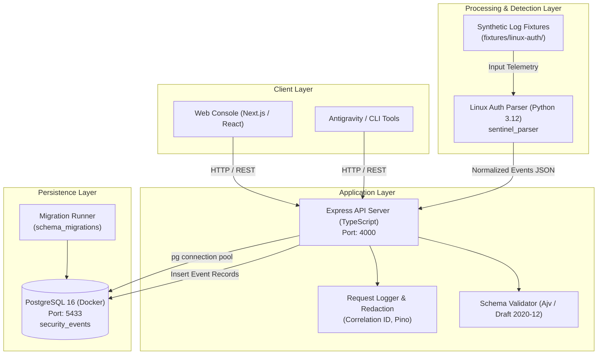

# NomaanOS Sentinel — System Architecture

**Version:** 0.1.0  
**Status:** Foundation Established  
**Date:** 2026-10-24

---

## 1. System Purpose & Target Audience

NomaanOS Sentinel is an AI-assisted cybersecurity threat detection, triage, and incident response platform designed specifically for Managed Service Providers (MSPs), IT consultants, and resource-constrained internal security operations.

The primary mission is to deliver high-confidence, deterministic threat detection coupled with evidence-grounded AI explanations and structured case management—without overwhelming analysts with false positives or risking tenant data leakage.

---

## 2. Component Responsibilities



### 2.1 Web Frontend (`apps/web`)
- **Technology**: Next.js 14 (App Router), React 18, TypeScript, Tailwind CSS, Lucide Icons.
- **Responsibilities**:
  - Presentation of security health status, detection alerts, investigation cases, and raw event exploration.
  - Multi-tenant client switching (MSP context).
  - Client-side data presentation with zero exposure of server secrets, raw credentials, or direct database connections.

### 2.2 API Server (`apps/api`)
- **Technology**: Node.js, Express, TypeScript, Ajv, Pino, pg (node-postgres).
- **Responsibilities**:
  - API routing and lifecycle management.
  - Health (`GET /health`) and readiness (`GET /ready`) monitoring.
  - Strict input validation against the canonical `security-event.schema.json`.
  - Structured application logging with automatic credential and header redaction.
  - Bounded payloads (max 2MB) and connection pooling with timeouts.

### 2.3 Security Parser Foundation (`services/parser`)
- **Technology**: Python 3.12, dataclasses, regex parsing engine, pytest.
- **Responsibilities**:
  - Parsing standard Linux authentication formats (`/var/log/auth.log` and `/var/log/secure`).
  - Normalizing heterogeneous log lines into canonical `NormalizedSecurityEvent` representations.
  - Preserving source line numbers and raw log text in `evidence` payloads.
  - Fault-tolerant processing: malformed or malicious inputs are safely counted without crashing.
  - Self-check diagnostics via `python -m sentinel_parser.cli --self-check`.

### 2.4 Log Ingestion Pipeline, Private Storage & PostgreSQL Job Queue
- **Technology**: Multer (bounded streaming), PostgreSQL atomic concurrency (`FOR UPDATE SKIP LOCKED`), Node.js `child_process.spawn`.
- **Responsibilities**:
  - Validating uploaded plain-text logs (`.log`, `.txt` up to 5 MiB, 50,000 lines, 16 KiB/line).
  - Verifying valid UTF-8 encoding and rejecting binary data/null bytes before disk persistence.
  - Generating opaque UUID storage keys and writing raw files to private workspace-scoped directories (`storage/workspaces/<workspaceId>/<storageKey>.log`).
  - Calculating SHA-256 file hashes to prevent concurrent duplicate processing within the same workspace.
  - Managing durable background jobs via `processing_jobs` table with atomic leasing and automated recovery of abandoned or crashed worker leases.
  - Invoking Python `sentinel_parser.cli` in a sandboxed child process with fixed arguments, `shell: false`, and a 30-second processing timeout.
  - Transactional event persistence binding normalized events to `workspace_id` and `dataset_id`.

### 2.5 Persistence Layer (`database/`)
- **Technology**: PostgreSQL 16 (running in Docker Compose).
- **Responsibilities**:
  - Storing normalized security events, user identities, sessions, workspaces, memberships, datasets, and background jobs.
  - Versioned migration tracking (`001_create_security_events.sql`, `002_create_auth_and_workspaces.sql`, `003_create_datasets_and_jobs.sql`).
  - High-performance indexing across `(tenant_id, occurred_at DESC)`, `(workspace_id, created_at DESC)`, `(workspace_id, file_sha256)`, and `(status, lease_expires_at)`.

---

## 3. Data Flow & Event Normalization Lifecycle

1. **Telemetry Ingestion**:
   - In the foundational implementation, synthetic or uploaded Linux logs are ingested via the parser or direct API batch ingestion.
2. **Parsing & Normalization**:
   - The Python parser decomposes raw log lines into timestamps (converted to UTC ISO 8601), source hosts, target usernames, originating IP addresses, ports, and event categories.
3. **Schema Validation**:
   - The payload is validated against `database/schema/security-event.schema.json`.
4. **Persistence & Evidence Retention**:
   - Valid records are stored in PostgreSQL with indexed search keys and JSONB structured evidence.
5. **Readiness & Observability**:
   - Health probes continuously monitor API liveness and database connection status.

---

## 4. Local Development Topology & Port Allocations

To avoid conflicts with existing host workloads:
- **Web Frontend**: `http://localhost:3000`
- **API Server**: `http://localhost:4000`
- **PostgreSQL**: Bound to `127.0.0.1:5433` (internal container port `5432`)
- **Docker Service**: `nomaanos-sentinel-database` (PostgreSQL 16 Alpine with readiness probe)

---

## 5. Architectural Decisions & Trade-Offs

| Decision | Rationale | Trade-Off |
|---|---|---|
| **Monorepo Structure** (`apps/*`, `services/*`) | Keeps web, API, parser, database schemas, and fixtures in one synchronized repository without multi-repo friction. | Requires workspace configuration for npm and Python path management. |
| **JSON Schema Draft 2020-12 as Single Source of Truth** | Guarantees that TypeScript (API) and Python (Parser) agree on field requirements, enums, and bounds. | Must maintain schema sync between TypeScript validators and Python models. |
| **Standard Library Parser Engine** | Zero external dependencies for the Python parser runtime minimizes supply-chain vulnerability attack surface. | Advanced syslog variations must be expanded with targeted regexes rather than heavy third-party log engines. |
| **Host Port 5433 for Postgres** | Pre-existing containers already occupy port 5432. Using 5433 prevents disruption of other local projects. | Configuration requires `.env` or `DATABASE_PORT=5433`. |
| **HttpOnly SameSite Session Cookies with DB Token Hashes** | Prevents XSS token theft and defends against read-only database snapshot token impersonation. | Requires session table lookups and periodic cleanup of expired sessions. |
| **Atomic Creator-Owner Workspace Provisioning** | Ensures every registered account immediately possesses an isolated organizational boundary without orphaned states. | Requires transactional registration flow. |

---

## 6. Authentication, Identity & Workspace Isolation Architecture

### 6.1 Password & Token Cryptography
- **Password Hashing**: `bcryptjs` with configurable salt rounds (10 development, 12 production). Plaintext passwords are never logged or stored.
- **Verification & Reset Tokens**: Cryptographically generated 32-byte random values (`crypto.randomBytes(32)`). Stored exclusively as SHA-256 hashes in `email_verification_tokens` and `password_reset_tokens`.
- **Session Validation**: Server-side session verification via `sessions` table joining `users`. Sessions are tracked with SHA-256 hashed tokens and invalidated upon logout or password reset.

### 6.2 Role-Based Access Control (RBAC) Matrix

| Permission / Capability | Owner | Admin | Analyst | Viewer |
|---|:---:|:---:|:---:|:---:|
| View Workspace Details & Telemetry | Yes | Yes | Yes | Yes |
| Ingest & Explore Security Events | Yes | Yes | Yes | Yes |
| View Team Members | Yes | Yes | Yes | No |
| Invite / Add Members (Admin/Analyst/Viewer) | Yes | Yes | No | No |
| Modify Member Roles (Non-Owner) | Yes | Yes | No | No |
| Demote / Remove Workspace Owner | Yes* | No | No | No |
| Transfer Sole Workspace Ownership | Yes | No | No | No |
| Cross-Workspace Access | No | No | No | No |

*\*Cannot demote or remove the sole remaining owner of a workspace.*

---

## 7. Implementation Status Matrix

| Component | Status | Verification Method |
|---|---|---|
| Repository Monorepo Scaffold | Implemented | Inspected and built |
| Docker Compose PostgreSQL | Implemented | Container healthy on `127.0.0.1:5433` |
| Database Migration Engine | Implemented | 2 migrations applied & verified idempotent |
| Canonical Security Event Schema | Implemented | Ajv & jsonschema tests passing |
| API Health & Readiness Probes | Implemented | Vitest & live integration tests passing |
| Structured Logging & Redaction | Implemented | Unit tests passing |
| Python Parser (`sentinel_parser`) | Implemented | Self-check & pytest test suite passing |
| Synthetic Linux Auth Fixtures | Implemented | 9 fixtures covering standard & edge scenarios |
| Authentication & Session Security | Implemented | Cookie-based HttpOnly sessions, bcrypt hashing, tokens |
| Email Verification & Password Reset | Implemented | Expiring single-use tokens, session invalidation on reset |
| Multi-Tenant Workspace Lifecycle | Implemented | Atomic workspace creation, membership constraints |
| Server-Side RBAC & Cross-Tenant Isolation | Implemented | 4 roles enforced; cross-workspace IDOR tests pass |
| Web Frontend UI & Auth Routes | Implemented | Login, Register, Forgot/Reset Password, Workspaces console |
| AI Investigation Engine | Implemented | Groq/OpenAI adapters, schema validation, case triage |
| Continuous Linux Agent & Live Ingestion | Implemented | Daemon collector, queue buffer, batch ingest, health probes |
| MSP Multi-Client Platform | Implemented | Centralized org console, consolidated alerts, fleet, usage, RBAC |

---

## 8. MSP Multi-Client Platform Architecture

### 8.1 Multi-Tenant Data Hierarchy

```
  +-----------------------------------------------------------+
  |                   MSP Organization                        |
  |  (id, name, slug, created_by, metadata, timestamps)       |
  +-----------------------------------------------------------+
         |                                           |
         | 1:N Members                               | 1:N Client Workspaces
         v                                           v
  +------------------------------+     +-------------------------------+
  |  Organization Memberships    |     |   Client Workspaces (Tenants) |
  |  (user_id, role, joined_at)  |     |   (organization_id, slug, ...) |
  +------------------------------+     +-------------------------------+
         |                                           |
         | Scoped administrative access              | 1:N Isolation Boundary
         v                                           v
  Across all Client Workspaces         Datasets, Security Events, Alerts,
                                       Cases, Integrations, Audit Logs
```

### 8.2 Tenant Isolation & Authorization Model

1. **Client Isolation Boundary**:
   - Every client workspace retains an isolated database perimeter (`workspace_id` foreign keys on `datasets`, `security_events`, `alerts`, `cases`, `integrations`, and `notifications`).
   - Client users belonging solely to Client Workspace A cannot read, query, list, or modify resources belonging to Client Workspace B, nor can they view the parent MSP Organization or sibling clients.
2. **MSP Staff Role Inheritance**:
   - MSP Organization members (`owner`, `admin`, `analyst`, `viewer`) automatically receive role-scoped access to all client workspaces under that organization.
   - Effective workspace permissions resolve via `COALESCE(direct_workspace_role, msp_org_role)`.
3. **Sole Owner Protection**:
   - The sole owner of an MSP organization cannot be demoted or removed without first transferring ownership to another verified staff member.
4. **Centralized Consolidated Operations**:
   - Consolidated endpoints (`/api/v1/organizations/:id/...`) execute inner-joined, tenant-scoped queries aggregating telemetry, alerts, fleet heartbeats, cases, and consumption metrics strictly for clients belonging to the authorized organization.
   - Usage endpoints provide granular event counts, 24-hour ingestion volumes, active servers, alert counts, and AI investigation metrics per client.


